# Model Relay

A self-hosted model gateway written in Go, with a React admin console. It exposes an OpenAI-compatible API, routes each request to a configured upstream provider, and records tokens, cost, latency and errors per API key.

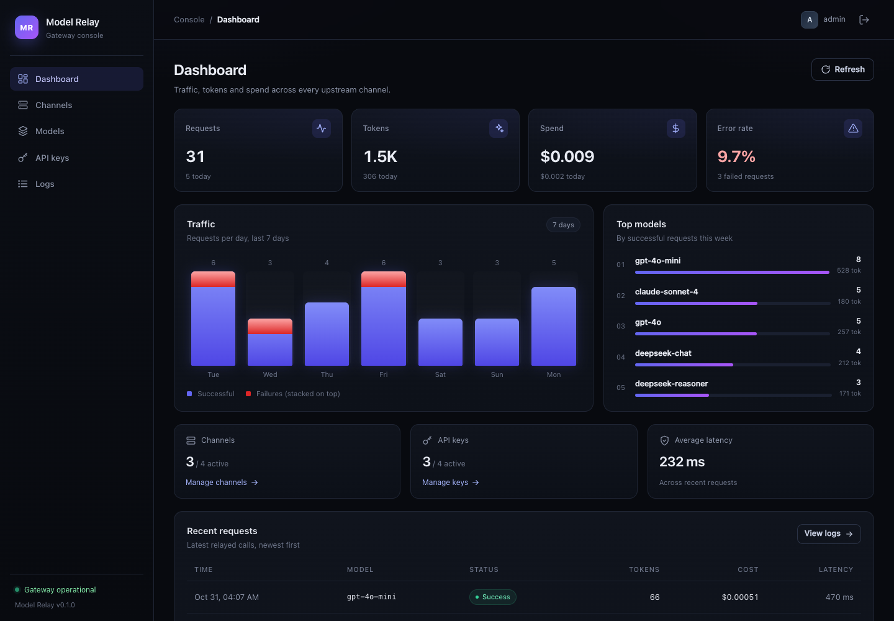

## Features

- **OpenAI-compatible relay** — `POST /v1/chat/completions` (streaming and non-streaming), `POST /v1/embeddings`, `GET /v1/models`.
- **Two chat upstream protocols** — OpenAI-compatible channels (OpenAI, DeepSeek, Moonshot, Qwen, vLLM, Ollama, …) and Anthropic Messages channels, translated to and from the OpenAI format.
- **MiniMax-H3 and Seedance video generation** — text-to-video and first-frame image-to-video from the console, with asynchronous tasks, live status, video preview and MP4 download. Supports MiniMax-H3 and ByteDance Seedance on Volcano Ark.
- **Channel routing** — priority first, weighted load balancing inside a priority, public-to-upstream model aliases, and automatic failover on connection errors, `401`, `403`, `404`, `429` and `5xx`.
- **Upstream model discovery** — fetch the provider's model list in the channel form, tick the models to import, and keep manual entries and public aliases.
- **Gateway keys** — per-key USD balance, daily spending budget, model allowlists, requests-per-minute, tokens-per-minute and concurrency limits, expiry, enable/disable, and a one-time plaintext reveal at creation.
- **Usage accounting** — prompt/completion tokens and cost from per-channel input/output prices, request logs with status, upstream model, latency and error detail.
- **Admin console** — dashboard with 7-day traffic, top models and recent requests; channel, model, API key and log pages.
- **Playground** — select an existing gateway key and try any model it can access: multi-turn chat, editable system prompt, temperature and max output, streaming, stop, and request IDs that link to the request log.
- **Simple to operate** — one Go binary with the console embedded, SQLite storage, no Redis or Postgres, graceful shutdown.
- **Ship-ready basics** — Dockerfile, docker-compose example, Makefile and GitHub Actions CI.

## Quick start

Requirements for building from source: Go 1.25+, Node.js 22+ and pnpm 10+.

```bash
make build
./bin/gateway
```

Open <http://localhost:8080> and sign in with the development credentials `admin` / `admin123`.

> Set `SECRET_KEY` and `ADMIN_PASSWORD` before exposing an instance. The admin password is only used when the database is first created.

### First request

1. **Channels** → *Add channel*. Use an OpenAI-compatible base URL including the version, e.g. `https://api.openai.com/v1`, enter the upstream key and list the upstream models — or click *Fetch models* and tick the ones to import.
2. **API keys** → *Create key*. Copy the `sk-…` value shown once.
3. Call the relay:

```bash
curl http://localhost:8080/v1/chat/completions \
  -H "Authorization: Bearer sk-..." \
  -H "Content-Type: application/json" \
  -d '{
    "model": "gpt-4o",
    "messages": [{"role": "user", "content": "Hello"}]
  }'
```

Streaming works with the usual OpenAI `"stream": true` flag. `GET /v1/models` lists the models exposed by enabled channels, filtered by the key's allowlist.

### Rate limits and budgets

Every gateway key can enforce several independent limits. A value of `0` means unlimited for the rate limits and the daily budget; the total balance uses `-1` for unlimited.

| Setting | Scope |
| --- | --- |
| **Quota (USD)** | Total balance for the key. Requests are rejected once recorded spend reaches it. |
| **Daily spend limit (USD)** | Spend on successful requests since local midnight, shown as “Today” in the API key list. |
| **Requests per minute (RPM)** | Sliding 60-second window. |
| **Tokens per minute (TPM)** | Sliding 60-second window over prompt and completion tokens. When a request is admitted, its estimated prompt plus the client's `max_tokens`/`max_completion_tokens` output limit (when declared) is reserved; the reservation is replaced by the upstream's actual usage when the request finishes. Requests without an output limit reserve their prompt and count completion tokens on settlement. |
| **Max concurrency** | Number of requests the key may have in flight at once. |

Additional key restrictions are the model allowlist and the expiry date. All of these apply to `/v1/chat/completions` and `/v1/embeddings`; `/v1/models` is free of rate-limit accounting.

A rejected request returns `429 Too Many Requests` with an OpenAI-compatible error: `rate_limit_exceeded` when a per-minute or concurrency limit is hit, and `insufficient_quota` when the balance or daily budget is exhausted. Rate-limit rejections also carry `Retry-After` and the current window in standard headers:

```text
X-RateLimit-Limit-Requests: 60
X-RateLimit-Remaining-Requests: 12
X-RateLimit-Reset-Requests: 31s
X-RateLimit-Limit-Tokens: 100000
X-RateLimit-Remaining-Tokens: 4200
X-RateLimit-Reset-Tokens: 12s
X-RateLimit-Limit-Concurrency: 4
X-RateLimit-Remaining-Concurrency: 3
```

Rate-limit windows are kept in memory by the running gateway. Restarting the process resets them (daily spend and the total balance are read from the request log and SQLite, so they survive restarts), and multiple gateway replicas do not share counters.

### Anthropic channels

Add a channel with protocol **Anthropic Messages**, base URL `https://api.anthropic.com/v1`, and a model mapping such as:

```text
claude-sonnet-4=claude-sonnet-4-20250514
```

Clients keep using the OpenAI chat format; the gateway translates requests and Anthropic SSE events in both directions. Public model names in mappings are also listed by `/v1/models`.

### Video generation (MiniMax-H3 and Seedance)

**MiniMax-H3.** Add a channel with protocol **MiniMax H3 (video)**, base URL `https://api.minimax.io` (or `https://api.minimaxi.com` for the China platform) and model `MiniMax-H3` (or one of the H3 variants). The API key is sent as `Authorization: Bearer …` to the MiniMax V2 video endpoints. The provider's OpenAI-compatible model list omits video models, so **Fetch models** adds the H3 family (`MiniMax-H3`, `MiniMax-H3-Highspeed`, `MiniMax-H3-Lite`, `MiniMax-H3-Max`) alongside the language models it returns.

**Seedance (Volcano Ark).** Seedance is ByteDance's video model on Volcano Engine Ark. Add a channel with protocol **Seedance (Volcano Ark, video)**, base URL `https://ark.cn-beijing.volces.com/api/v3`, and the model IDs to serve, for example `doubao-seedance-1-0-pro-250528` or `doubao-seedance-1-0-pro-fast-251015`. **Fetch models** reads `GET /api/v3/models` and also offers the Seedance family; public aliases such as `my-video=doubao-seedance-2-0-260128` are supported. The key is sent as `Authorization: Bearer …` to `POST /api/v3/contents/generations/tasks`, and task status is polled at `GET /api/v3/contents/generations/tasks/{id}`.

#### Getting a Seedance API key

1. Sign in to the [Volcano Engine console](https://console.volcengine.com/ark) and complete real-name verification if prompted.
2. Open **Volcano Ark → API Key management** (<https://console.volcengine.com/ark/region:ark+cn-beijing/apikey>) and create an API key. Copy it and keep it secret.
3. Open **Volcano Ark → Activation management** (<https://console.volcengine.com/ark/region:ark+cn-beijing/openManagement>) and enable the Seedance model you plan to call, for example `doubao-seedance-1-0-pro-250528`. Model IDs are listed in the [Volcano Ark model list](https://ark.volcengine.com/region:cn-beijing/docs/model-list).
4. Paste the key into the channel's **API key** field. Video channels are separate from chat routing, so Seedance models are not exposed by `/v1/chat/completions` or `/v1/models`.

Then open **Video** in the console to:

1. pick a video model and enter a prompt;
2. optionally attach a first-frame image (PNG, JPEG, WEBP, HEIC or HEIF, up to 30 MB) for image-to-video;
3. choose resolution, duration and, for text-to-video, an aspect ratio. The form offers the values each model supports: MiniMax uses 480P/768P/2K and 4–15 s; Seedance uses 480p/720p/1080p (plus 4k on some 2.x models) and 2–12 s, 4–15 s or 4–30 s depending on the model family.

The gateway submits the asynchronous task, polls it in the background, and stores the finished MP4 under `DATA_DIR/videos/`. Finished videos can be previewed in the browser and downloaded with the **Download MP4** action. Tasks left in flight are resumed after a restart. Video generation is console-only for now: it is not metered per gateway key and does not appear in request logs.

### Docker

```bash
docker build -t model-relay .
docker run --rm -p 8080:8080 \
  -e SECRET_KEY='replace-with-a-long-random-string' \
  -e ADMIN_PASSWORD='replace-me' \
  -v model-relay-data:/data \
  model-relay
```

For Compose, create a `.env` file containing `SECRET_KEY` and `ADMIN_PASSWORD` (see the configuration table), then run `docker compose up --build`. The compose file loads that file via `env_file` and refuses to start without it.

## Configuration

| Variable | Default | Description |
| --- | --- | --- |
| `PORT` | `8080` | HTTP listen port. |
| `DATA_DIR` | `./data` | Directory for `gateway.db` and downloaded videos (created automatically). |
| `SECRET_KEY` | `dev-secret-change-me` | Signs admin sessions and encrypts upstream API keys with AES-256-GCM. Use a stable secret. |
| `ADMIN_USERNAME` | `admin` | Admin username created on first boot. |
| `ADMIN_PASSWORD` | `admin123` | Admin password created on first boot (minimum 6 characters). |
| `SESSION_TTL_HOURS` | `24` | Admin session lifetime. |
| `REQUEST_TIMEOUT_SECONDS` | `300` | Timeout for non-streaming upstream requests. A timeout after the request may have reached the provider is booked as an unverified charge. |
| `STREAM_TIMEOUT_SECONDS` | `1800` | Hard overall limit for a streaming request. It bounds how long a stream can hold a quota reservation. Set to `0` to disable the cap. |
| `QUOTA_DEFAULT_OUTPUT_TOKENS` | `4096` | Output-token cap used for finite-quota keys when a chat request omits `max_tokens`/`max_completion_tokens`. The gateway sends this cap upstream so the quota reservation is a real upper bound. |
| `VIDEO_POLL_SECONDS` | `8` | How often asynchronous video tasks are polled. |

Changing `SECRET_KEY` invalidates admin sessions and makes existing channel keys undecryptable — re-enter the upstream keys after rotating it.

## Admin console

| Dashboard | Channels |
| --- | --- |
|  | 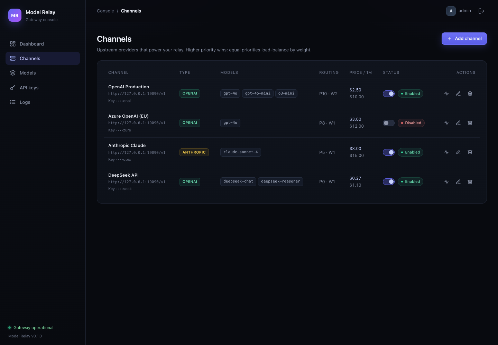 |

| API keys | Request logs |
| --- | --- |
| 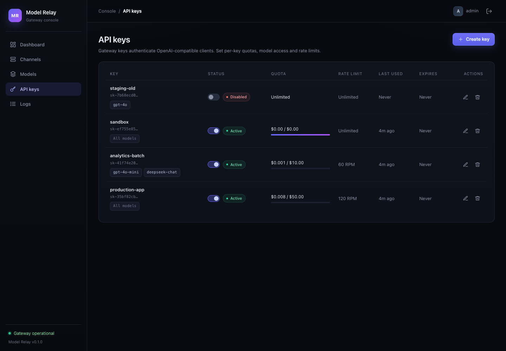 | 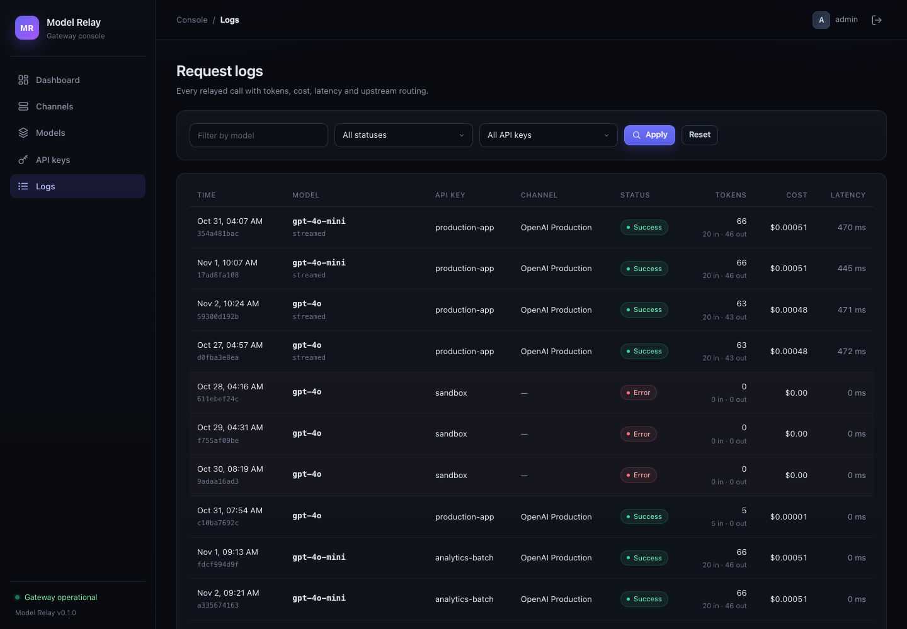 |

| Playground (dark) | Playground (light) |
| --- | --- |
| 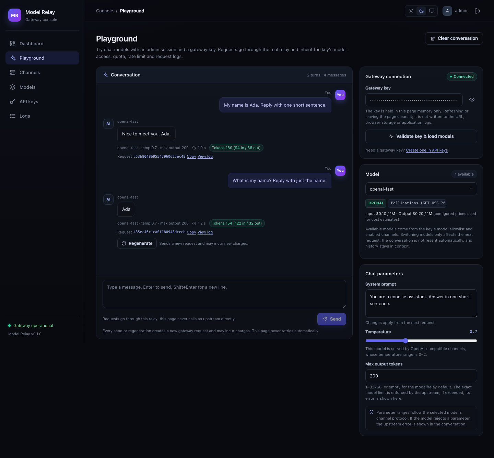 | 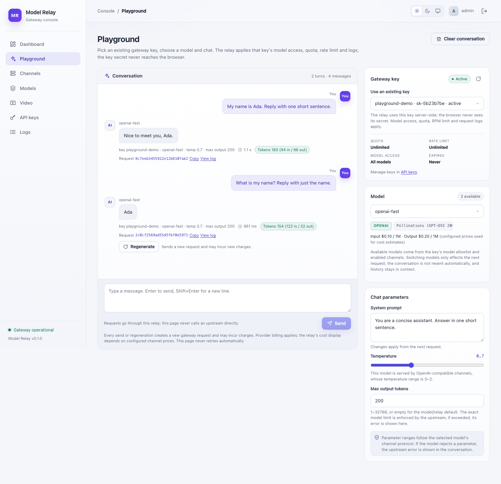 |

| Video generation | MiniMax model import |
| --- | --- |
| 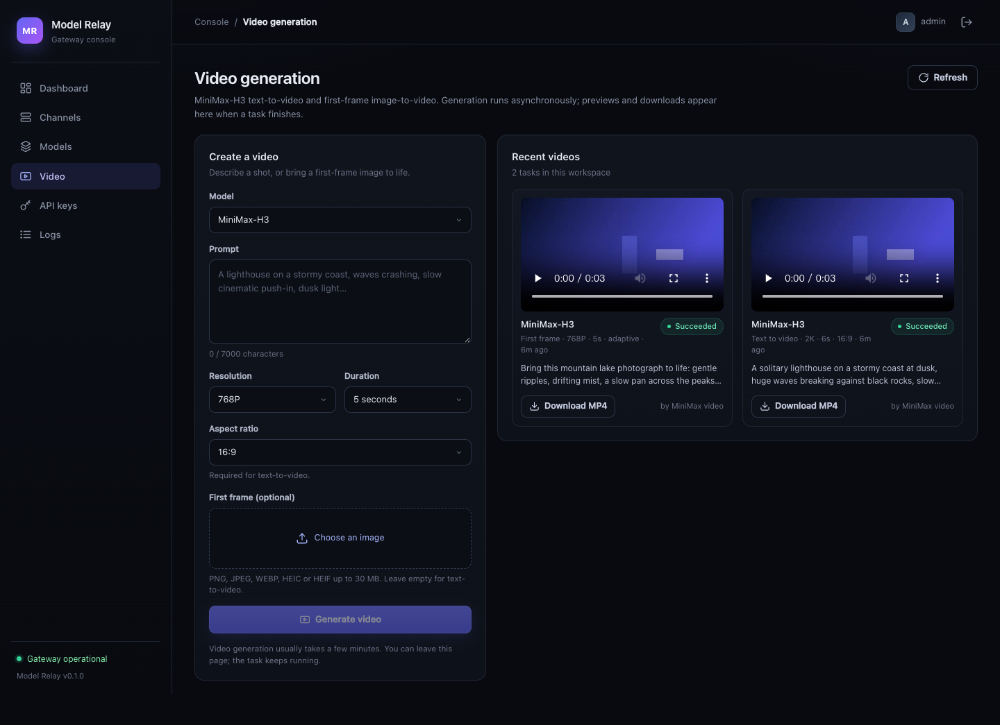 | 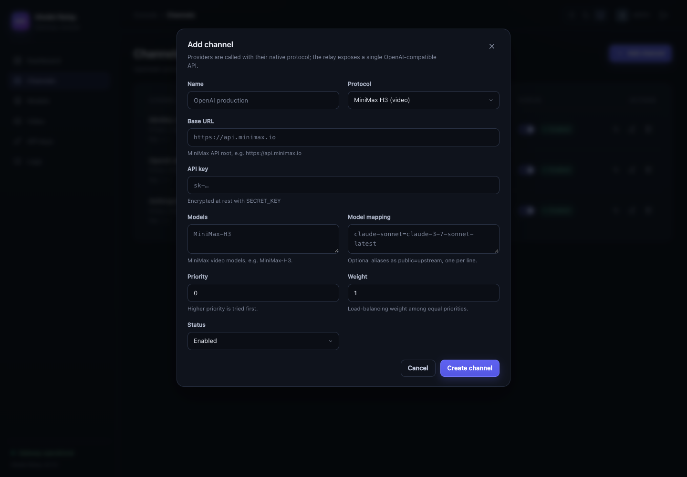 |

| Video generation (Seedance) | Seedance channel |
| --- | --- |
| 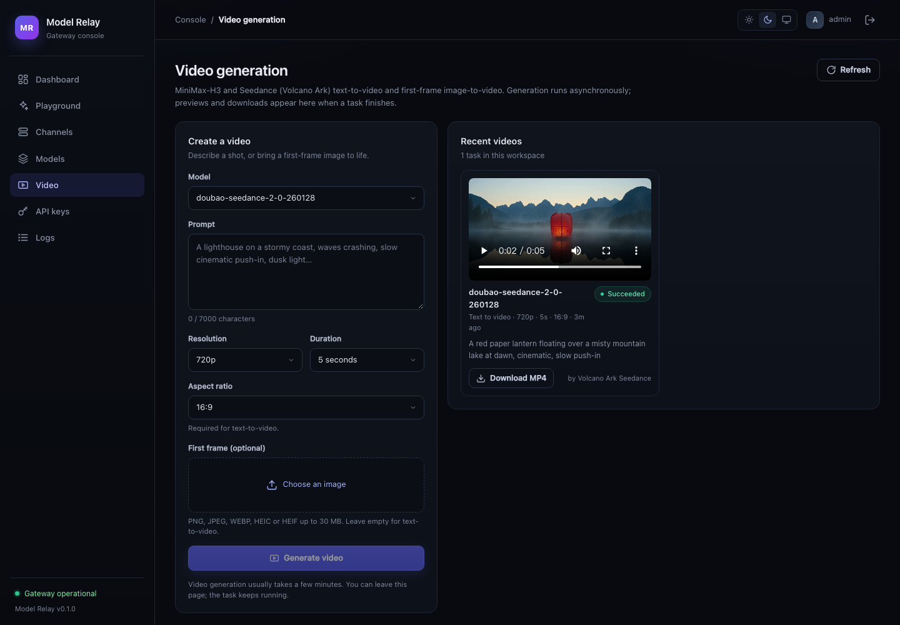 | 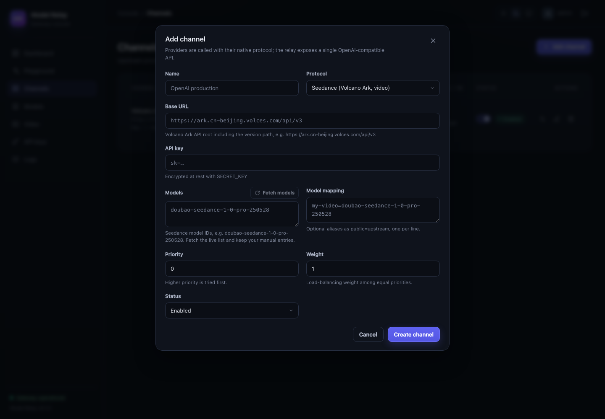 |

The **Models** page shows the public catalog, serving channels and the lowest configured price per model. Star the models you use most to keep them in a favorites list, then use **Favorites only** to narrow the catalog; favorites are stored in the browser and survive reloads. The **Playground** page selects an existing gateway key, sends real relay requests, and shows streaming output, latency, token usage and the request ID. Most screenshots use the local mock upstream in `scripts/mock-upstream.py` (`python3 scripts/mock-upstream.py 19090`), so `127.0.0.1` URLs are demo data rather than real providers; the mock also answers MiniMax and Seedance video create/query calls and serves `scripts/media/demo.mp4` for local previews. The MiniMax and Seedance video screenshots additionally include one real generation each (`MiniMax-H3` and `doubao-seedance-2-0-260128`), and the Playground uses a public Pollinations GPT-OSS endpoint.

Use the theme control in the top bar, or on the sign-in screen, to switch between light, dark and follow-system themes. The console remembers the selection in the browser.

The channel form can fetch the provider's model list and import selected models with checkboxes. Manual entries and model aliases stay editable, and a failed fetch leaves the form and the saved channel untouched.

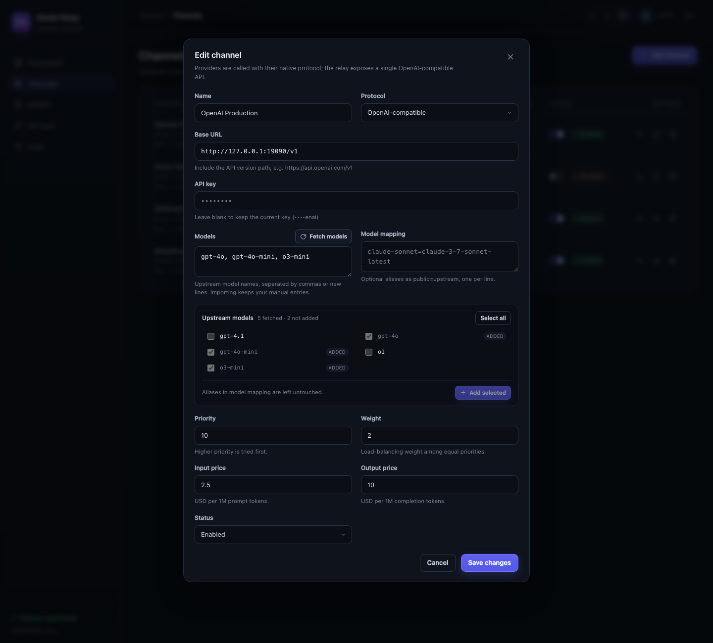

## Playground

Open **Playground** in the console after signing in and choose one of the gateway keys created on **API keys**. The relay applies that key's model allowlist, quota, RPM limit, channel routing and request logging; the browser never receives the key secret, and the page never calls an upstream directly.

1. Select an existing gateway key from **Gateway key**. Create one on **API keys** first if the list is empty. The relay uses the key server-side; its secret is never sent to the browser.
2. Pick a model. The available models come from `GET /api/playground/models` and are filtered by the selected key's allowlist and enabled channels; protocol chips and prices come from the model catalog. The temperature range follows the serving protocol (Anthropic channels cap it at 1).
3. Optionally edit the system prompt, temperature and maximum output tokens, then send a message. Multi-turn history, including earlier assistant replies, is sent as context on the next request.
4. Responses stream into the conversation. **Stop generating** aborts the browser read and cancels the upstream request through the relay's request context; content already generated may still be billed. **Regenerate** asks for confirmation first because it creates a new request. **Clear conversation** removes the page's messages but not existing request logs or charges.
5. Each completed reply shows the relay request ID, round-trip latency and token usage. Usage reported by the upstream is labeled as reported; if the upstream omits it, the gateway's final SSE usage chunk is marked `x_usage_source: "estimated"` and the page labels the value as an estimate instead of presenting it as exact. **View log** opens **Logs** filtered by that request ID.

The page uses the console theme tokens and works in light, dark and follow-system themes, including the request log and confirmation dialogs.

The browser sends only the selected key's id. Playground calls the admin-authenticated `POST /api/playground/chat`, which invokes the same relay handler as `/v1/chat/completions`, so the key's model permissions, quota, RPM limit and request log all apply; the key secret stays on the server and is never written to the URL, browser storage or the console's request logs. The conversation is not stored server-side — only normal relay request logs remain. Parameter ranges are protocol-level constraints; model-specific limits (for example, reasoning models that reject temperature) are enforced by the upstream, and a rejection is shown in the conversation.

See [docs/playground.md](docs/playground.md) for the full usage guide, parameter rules and the real-call verification record with request IDs.

## Routing and accounting

- A channel serves a model when the model appears in its **models** list, or when it is a **public name in the model mapping**.
- Candidates are sorted by descending priority. Within one priority, weight influences a randomized order, so traffic is spread across equivalent channels.
- If an upstream call fails before any response bytes reach the client, the next candidate is tried. Streaming responses that have already started are not retried.
- Cost is calculated as `prompt_tokens × input_price / 1M + completion_tokens × output_price / 1M`, using prices configured on the channel that served the request.
- Upstream `usage` is used when present (`actual`). For streams without usage and for providers that omit it, the gateway records a conservative estimate based on the request and returned text (`estimated`).
- When a stream omits usage, the relay appends an OpenAI-style final usage chunk whose `x_usage_source` field is `"estimated"`, so clients can tell exact and estimated numbers apart. Anthropic streams also include a translated usage chunk.

### Quota reservations and settlement

Finite-quota keys are admitted against a balance that includes in-flight reservations:

```text
available = quota - used_quota - SUM(pending reservation amounts)
```

The reservation is created atomically in SQLite before the request is sent upstream, so two concurrent requests for the same key cannot spend the same balance. Before sending, the gateway computes a cost upper bound:

- Prompt tokens: the request body's byte length plus chat framing overhead. A token never encodes fewer than one byte, so this is a true upper bound (conservative for text and image payloads).
- Completion tokens: the client's `max_tokens`/`max_completion_tokens` (the larger one) multiplied by `n`. When the client omits a limit and the key has a finite quota, the gateway injects `max_tokens = QUOTA_DEFAULT_OUTPUT_TOKENS` so the upstream cannot generate more than was reserved.
- Price: the highest input/output price among the candidate channels, so a failover to a more expensive channel stays covered.

If the upper bound does not fit in the available balance, the request is rejected with HTTP `429`, `type: insufficient_quota`, and a message stating the required and available amounts. Requests are never serialized globally; unrelated keys and requests that fit their own balance proceed concurrently.

Every reservation is finalized exactly once, in one SQLite transaction that updates `used_quota` and writes the request log. A duplicate completion notification for the same reservation is ignored. The log records `cost_status`:

| `cost_status` | Meaning |
| --- | --- |
| `actual` | Upstream reported token usage; cost is computed from it. |
| `estimated` | Upstream omitted usage; cost is computed from locally counted request/response text. |
| `unverified` | Real usage is unknown after a timeout, cancellation, restart or a 2xx response whose body could not be read. The reserved upper bound is charged and surfaced for review. |
| `free` | No upstream usage was possible (rejected before the call, dial/DNS failure) or the upstream rejected the request before generation. No charge. |

Failure handling:

- Pre-call failures (validation, authorization, rate limit, no channel, insufficient quota, key decryption, dial/DNS errors) are not charged.
- A non-2xx upstream response is retried on the next candidate and is not charged if all candidates fail. An upstream `400`/`422` is returned without a charge.
- Once an upstream returns `2xx`, the request is never retried on another channel. A stream that breaks, a client cancellation, or a timeout is settled from the usage received so far (`actual`/`estimated`) or at the reserved upper bound (`unverified`) when usage is unknowable. This avoids double-billing the same request.
- Channel failover before any response bytes charges only the channel that finally serves the request.

### Restart recovery

This is a single-node gateway, so a reservation found `pending` at startup cannot still be running. `RecoverPendingReservations` runs on every boot and, for each such request:

1. charges the reserved upper bound to the key,
2. marks the reservation `recovered` and the charge `unverified`,
3. writes an error log explaining that the process restarted before completion.

Settled charges are committed in SQLite and are not lost. In-flight holds are therefore never released for free and never lock a key forever. The admin ledger endpoint `GET /api/ledger` lists recent reservations and their states; the dashboard shows unverified spend separately from the note in the Spend card, and the Request logs page shows the cost basis for every call.

A key with quota `-1` is unlimited: it still gets reservations and records usage, but it is never rejected for balance. `rpm_limit: 0` means unlimited. Model allowlists and RPM limits are enforced before the reservation and are unchanged.

### Known limits

- Reservations use a byte-based prompt-token upper bound. It is safe but deliberately conservative, especially for large image payloads; a finite-quota key may be able to keep less work in flight than its nominal balance suggests.
- A provider that ignores `max_tokens` (or bills for a failed request) can exceed the reserved upper bound. The gateway still settles the actual reported cost and logs a warning, but it cannot prevent an upstream that violates its own limits from overcharging.
- A non-2xx upstream response during failover is treated as unbilled because no usage is reported. Providers that charge for rejected or failed requests cannot be detected from a non-2xx response; those charges are invisible to the gateway and must be reconciled with the provider.
- Prompt upper bounds count the serialized body, so multimodal inputs and large JSON payloads reserve much more than their eventual token cost. This is deliberate: it keeps the hold conservative, and the unused amount is released at settlement.
- `unverified` charges are conservative by design: when a timeout or cancellation happens after the request may have reached the provider, the reserved upper bound is charged instead of silently recording zero. Review them in Request logs; the gateway does not currently provide an automatic refund workflow.
- The reservations are enforced with SQLite transactions on one node. Multi-node deployments would need a shared transactional store and are out of scope.

## HTTP API

Admin endpoints use the `mr_session` HttpOnly cookie created by `POST /api/auth/login`. Gateway endpoints use `Authorization: Bearer sk-…` (or `x-api-key`).

| Endpoint | Auth | Purpose |
| --- | --- | --- |
| `POST /api/auth/login` | — | Sign in; sets the session cookie. |
| `POST /api/auth/logout` | session | Clear the session cookie. |
| `GET /api/auth/me` | session | Current admin. |
| `GET /api/dashboard` | session | Totals, 7-day series, top models and recent logs. |
| `GET/POST /api/channels` | session | List/create channels. |
| `GET/PUT/DELETE /api/channels/{id}` | session | Read/update/delete a channel. |
| `POST /api/channels/upstream-models` | session | Fetch the provider's model list for the form; an existing channel reuses its stored key. |
| `POST /api/channels/{id}/test` | session | Send a minimal upstream request and report latency. |
| `GET/POST /api/tokens` | session | List/create gateway keys. Creation returns the plaintext key once. |
| `PUT/DELETE /api/tokens/{id}` | session | Update/delete a key. |
| `GET /api/logs` | session | Paginated logs; filters: `model`, `status`, `request_id`, `token_id`, `start`, `end`, `page`, `page_size`. |
| `GET /api/ledger` | session | Recent quota reservations and pending cost; `limit` defaults to 100. |
| `GET /api/models` | session | Model catalog with channels, protocols and prices. |
| `GET /api/playground/models?token_id=…` | session | Models available to a selected gateway key for Playground. |
| `POST /api/playground/chat?token_id=…` | session | Relay a Playground chat as the selected gateway key; the browser never receives the key secret. |
| `GET/POST /api/videos` | session | List video tasks / submit a MiniMax-H3 generation task. |
| `GET /api/videos/{id}` | session | One video task with status and metadata. |
| `GET /api/videos/{id}/content` | session | Preview the stored MP4; add `?download=1` for an attachment. |
| `GET /v1/models` | gateway key | OpenAI model list, filtered by the key. |
| `POST /v1/chat/completions` | gateway key | OpenAI-compatible chat completions, streaming supported. |
| `POST /v1/embeddings` | gateway key | Embeddings passthrough for OpenAI-compatible channels. |
| `GET /healthz` | — | Liveness check. |

Gateway responses include an `X-Request-Id` header; the same value is stored on the request log, so it can be pasted into the log page filter or queried with `GET /api/logs?request_id=…`. Gateway errors use the OpenAI error envelope, e.g. `{"error":{"message":"…","type":"invalid_api_key","code":"invalid_api_key"}}`.

## Development

```bash
make test        # Go tests + TypeScript typecheck
make vet         # go vet
make build       # web build + embedded single binary
make dev         # Vite dev server on :5173, proxying /api and /v1 to :8080
```

Run the backend separately with `go run ./cmd/server` (serves a "console not built" placeholder unless built with `-tags embed`).

`scripts/quota-test-upstream.py` is a deterministic local upstream for quota, streaming and recovery checks. Model names select behaviour (`ok-model`, `no-usage-model`, `stream-break-model`, `fail-model`, `slow-model`, `embed-model`); see the script header for details.

Project layout:

```text
cmd/server/            entrypoint
internal/auth/         password hashing, API keys, session JWTs
internal/config/       environment configuration
internal/gateway/      relay, routing, OpenAI/Anthropic adapters, video tasks, accounting
internal/secretbox/    AES-GCM encryption for upstream keys
internal/server/       HTTP API, middleware, static console
internal/store/        SQLite schema and queries
web/                   React + TypeScript admin console (Vite)
scripts/               development helpers
docs/screenshots/      console screenshots used in this README
```

## Security notes and limitations

- This is a focused self-hosted gateway, not a hosted billing platform. There is **one admin account**; API keys do not belong to separate end users, and there is no registration, team or role system.
- SQLite uses a single writer. It is a good fit for a small team or a single-node deployment; horizontal scaling would require an external database and shared rate-limit state, which are not implemented.
- The default `SECRET_KEY` and `ADMIN_PASSWORD` are development values. Use a long random secret and a strong password, terminate TLS in front of the gateway, and treat `SECRET_KEY` as a credential.
- Upstream channel URLs are configured by an authenticated admin. The gateway will fetch whatever URL is configured, so restrict admin access accordingly.
- The Anthropic adapter translates text, image data URLs, tool calls and tool results. Remote image URLs are not converted. OpenAI's Responses API, audio, rerank and native Anthropic endpoints are out of scope.
- MiniMax-H3 video tasks are managed from the admin console; there is no gateway-key video API and video generation is not charged against key quotas. Task history and downloaded MP4 files stay in `DATA_DIR` until removed manually.
- Cost accounting trusts the configured prices and upstream token counts; it is an operational estimate, not an invoice. `estimated` and `unverified` charges are marked explicitly and should be reviewed before using the numbers for billing.
- Playground uses the selected gateway key through an admin-authenticated server endpoint; the browser never receives the key secret. An admin session can therefore spend any key's quota, so restrict admin access accordingly.
- Playground parameter ranges are protocol-level. Model-specific limits are enforced by the upstream and surfaced as errors; the page does not maintain a per-model capability database.
- Channel failover is retried for listed transient statuses. A `400`/`422` from an upstream is returned to the client because it usually reflects the request rather than channel health.

## Upgrading an existing installation

The SQLite schema is migrated automatically on startup: the gateway adds `logs.cost_status`, `logs.reserved_cost`, `logs.reservation_id` and the `token_reservations` table when they are missing, along with the per-key limit columns (`tpm_limit`, `max_concurrency`, `daily_quota`) and the `video_tasks` table introduced on `main`. No manual database step is required.

Existing keys and channels keep their configuration. Because the previous version had no reservations, the first boot after the upgrade has no pending reservations to recover; settled historical costs remain as recorded. New optional environment variables (`STREAM_TIMEOUT_SECONDS`, `QUOTA_DEFAULT_OUTPUT_TOKENS`) default to the values in the table above. Restart the binary (or rebuild the Docker image) as usual.

## Design notes

The channel/key/log model and admin flows are inspired by [new-api](https://github.com/QuantumNous/new-api); the "translate each provider to the OpenAI format" adapter approach follows the spirit of [LiteLLM](https://github.com/BerriAI/litellm). This repository is an independent Go + React implementation.
